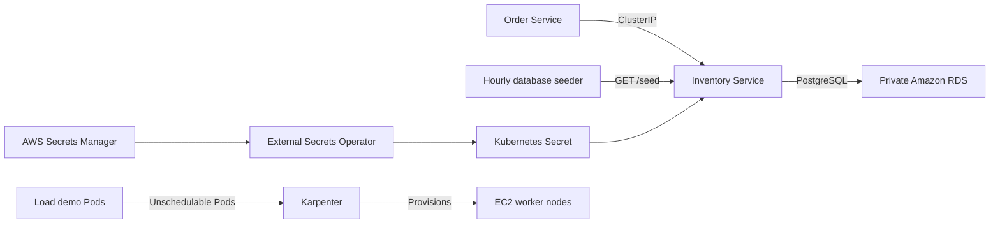

# ERP Platform on AWS EKS

A hands-on AWS deployment of a sample ERP backend. The Order Service calls the Inventory Service over Kubernetes service discovery and uses stock records from a private PostgreSQL database to build sample orders.

## What I implemented

- **Infrastructure as code.** Provisioned an Amazon EKS 1.35 cluster, a VPC spanning two Availability Zones, and Amazon RDS for PostgreSQL 16 with Terraform. Placed worker nodes and the database in private subnets and allowed PostgreSQL traffic from the EKS node security group.
- **Container delivery and Kubernetes workloads.** Containerized the two Node.js services for Amazon ECR and defined their EKS Deployments with two replicas each, CPU and memory requests, readiness and liveness probes, and internal ClusterIP Services.
- **Workload identity and database credentials.** Configured EKS Pod Identity for External Secrets Operator and limited its IAM permissions to the database secret in AWS Secrets Manager. The operator syncs the credentials into a Kubernetes Secret that the Inventory Service consumes.
- **Database and scheduled automation.** Wrote the PostgreSQL schema and sample data, implemented the inventory read and seed endpoints, and scheduled a Kubernetes CronJob to add a randomized inventory record every hour.
- **Node autoscaling.** Configured Karpenter to discover the cluster's private subnets and node security group by tag. Built a repeatable demo that requests five vCPUs across ten Pods so a reviewer can observe provisioning when capacity is full and consolidation when the load is removed.

## Problems I solved in the lab

- **AWS region permissions.** Traced a Terraform plan failure to an AWS Organizations policy that denied the Availability Zone lookup in `us-east-1`. Verified the plan and provisioned the stack in Sydney (`ap-southeast-2`).
- **Karpenter compatibility and launch permissions.** Migrated the controller's authentication to EKS Pod Identity after the Terraform EKS v21 submodule removed its IRSA inputs. Configured the NodePool for On-Demand `t3.small` instances to match the lab's launch permissions.

## Architecture



| Directory | Contents |
| --- | --- |
| [`infra/`](infra/) | Terraform for the VPC, EKS 1.35, RDS PostgreSQL 16, Secrets Manager, and IAM. Includes the database initialization script. |
| [`services/`](services/) | Node.js source and Dockerfiles for Inventory and Order. |
| [`k8s/`](k8s/) | Service deployments, External Secrets resources, the seeder CronJob, Karpenter node configuration, and the load demo. |

## Prerequisites

- Terraform 1.5.7 or later, AWS CLI, `kubectl`, Helm, and Docker with Buildx.
- AWS credentials permitted to provision the stack and push to Amazon ECR. The lab uses Sydney (`ap-southeast-2`), which also matches the checked-in Secrets Manager and ECR configuration.
- Run the PowerShell examples from the repository root. Keep database passwords and Terraform state outside Git.

## Deploy

### 1. Provision AWS infrastructure

```powershell
$region = 'ap-southeast-2'
$env:TF_VAR_region = $region

terraform -chdir=infra init
terraform -chdir=infra plan
terraform -chdir=infra apply
```

Provide `db_password` when Terraform prompts for it, or set it through your normal secret input method. The default cluster name is `erp-cluster` and the default database name is `erpdb`.

```powershell
$cluster = terraform -chdir=infra output -raw cluster_name
aws eks update-kubeconfig --region $region --name $cluster
kubectl get nodes
```

### 2. Install the controllers and sync the database credentials

Terraform creates EKS Pod Identity associations for the External Secrets and Karpenter service accounts. Install the controllers with matching names and namespaces. The Karpenter example uses [v1.12.0](https://github.com/aws/karpenter-provider-aws/releases/tag/v1.12.0), which meets the [Kubernetes 1.35 requirement](https://karpenter.sh/docs/upgrading/compatibility/).

```powershell
helm repo add external-secrets https://charts.external-secrets.io
helm repo update
helm upgrade --install external-secrets external-secrets/external-secrets --namespace external-secrets --create-namespace --set serviceAccount.name=external-secrets --wait

helm upgrade --install karpenter oci://public.ecr.aws/karpenter/karpenter --version 1.12.0 --namespace kube-system --set serviceAccount.name=karpenter --set "settings.clusterName=$cluster" --set "settings.interruptionQueue=Karpenter-$cluster" --wait

kubectl apply -f k8s/external-secret.yaml
kubectl wait -n default --for=condition=Ready externalsecret/erp-db-credentials --timeout=180s
```

With the default cluster name, External Secrets reads `erp-cluster/db-credentials` from Secrets Manager and refreshes the Kubernetes Secret `erp-db-credentials` hourly. If you changed the region or cluster name, update the store's `region` and the secret's `remoteRef.key` entries in [`external-secret.yaml`](k8s/external-secret.yaml).

### 3. Build and deploy the services

Create the private ECR repositories `erp/inventory-service` and `erp/order-service` in the deployment region if they do not already exist. [Amazon ECR repository setup](https://docs.aws.amazon.com/AmazonECR/latest/userguide/repository-create.html)

```powershell
$account = aws sts get-caller-identity --query Account --output text
$registry = "$account.dkr.ecr.$region.amazonaws.com"

aws ecr get-login-password --region $region | docker login --username AWS --password-stdin $registry
docker buildx build --platform linux/amd64 --tag "$registry/erp/inventory-service:latest" --push services/inventory-service
docker buildx build --platform linux/amd64 --tag "$registry/erp/order-service:latest" --push services/order-service
```

Set each Deployment's `image` in [`inventory-service.yaml`](k8s/inventory-service.yaml) and [`order-service.yaml`](k8s/order-service.yaml) to the URI you pushed.

```powershell
kubectl apply -n default -f k8s/inventory-service.yaml -f k8s/order-service.yaml
kubectl rollout status -n default deployment/inventory-service --timeout=180s
kubectl rollout status -n default deployment/order-service --timeout=180s
```

### 4. Initialize and test the database

[The SQL script](infra/init.sql) creates the inventory table and inserts five sample records. Run it once against the new database. The command below streams the script into an Inventory Service Pod and uses that Pod's database credentials and private network access. Each rerun inserts another set of sample records.

```powershell
$initDatabase = @'
const { Client } = require('pg');
const sql = require('node:fs').readFileSync(0, 'utf8');
const { DB_HOST, DB_PORT, DB_USER, DB_PASSWORD, DB_NAME } = process.env;
const client = new Client({
  host: DB_HOST, port: Number(DB_PORT), user: DB_USER,
  password: DB_PASSWORD, database: DB_NAME, ssl: { rejectUnauthorized: false }
});
(async () => {
  await client.connect();
  try { await client.query(sql); }
  finally { await client.end(); }
})().catch(error => {
  console.error(error.message);
  process.exitCode = 1;
});
'@
Get-Content -Raw infra/init.sql | kubectl exec -i -n default deployment/inventory-service -- node -e $initDatabase
kubectl apply -f k8s/db-seeder-cronjob.yaml
kubectl port-forward -n default svc/order-service 8081:8080
```

Leave the port-forward running and call `Invoke-RestMethod http://localhost:8081/orders` in a second terminal. The response includes two sample orders populated from the database through the Inventory Service.

| Service | Endpoint | Behavior |
| --- | --- | --- |
| Both | `GET /health` | Returns process health for Kubernetes probes. |
| Inventory | `GET /inventory` | Lists inventory records from PostgreSQL. |
| Inventory | `GET /seed` | Inserts one randomized record. The CronJob calls it hourly. |
| Order | `GET /orders` | Returns two sample orders using the Inventory Service response. |

## Demonstrate Karpenter scaling

Get the node IAM role name from Terraform and use it as `spec.role` in the `EC2NodeClass` in [`karpenter-nodepool.yaml`](k8s/karpenter-nodepool.yaml). If you changed the cluster name, update both discovery tag values to match it. The sample NodePool provisions On-Demand `t3.small` nodes.

```powershell
terraform -chdir=infra output -raw karpenter_node_role_name
```

```powershell
kubectl apply -f k8s/karpenter-nodepool.yaml
kubectl apply -f k8s/load-generator.yaml
kubectl get nodeclaims -w
```

The load Deployment creates ten Pods requesting 500 millicores each. Karpenter can provision nodes when those Pods cannot fit on existing capacity. Stop the watch with Ctrl+C and run `kubectl get nodes` to see the workers. Remove the load Deployment with `kubectl delete -f k8s/load-generator.yaml` so Karpenter can consolidate unused nodes.

## Clean up

Delete the load generator and the NodePool while the Karpenter controller is running. Wait for the Karpenter-managed NodeClaims and their EC2 instances to terminate before destroying the cluster.

```powershell
kubectl delete -f k8s/load-generator.yaml --ignore-not-found
kubectl delete nodepool default --ignore-not-found
kubectl get nodeclaims
```

Review `terraform -chdir=infra plan -destroy`, then run `terraform -chdir=infra destroy` with the same region and inputs used for deployment. RDS deletion skips the final snapshot. Remove any ECR repositories you created for this lab separately once their images are no longer needed.
